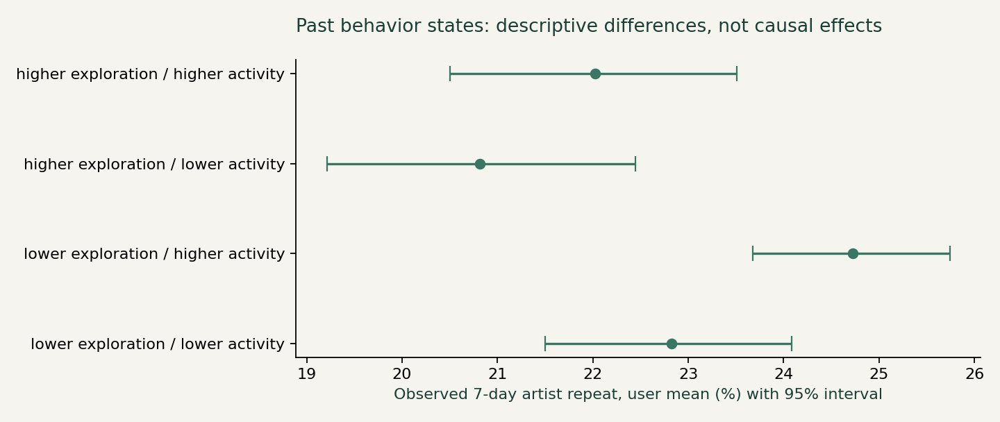
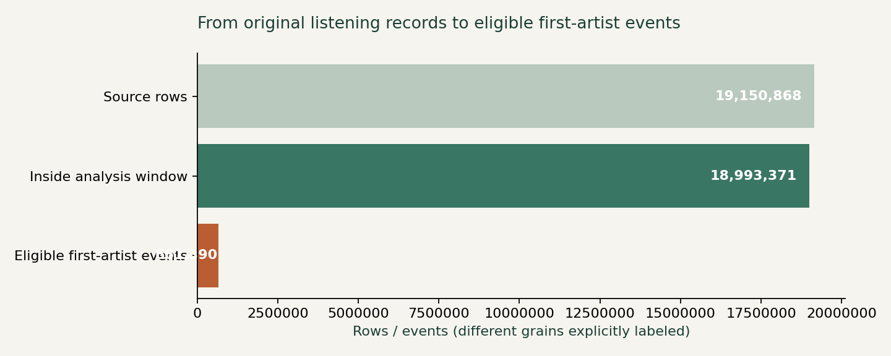
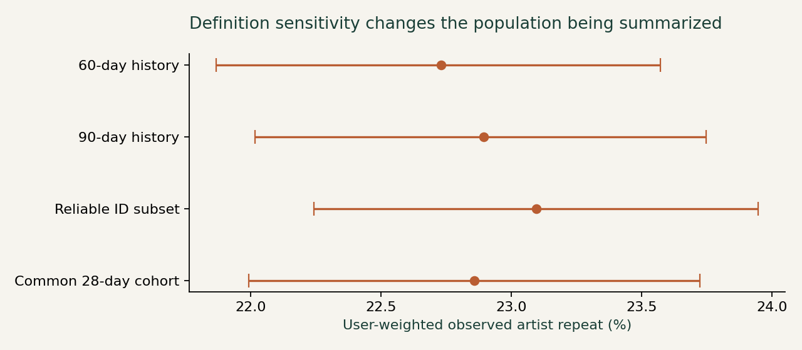

# Music Discovery and Repeat Listening

**Product question:** Should a music product prioritize active exploration, familiar-content access, or retrieval of recent discoveries?

**Decision:** research the need before building a retrieval feature. Real historical logs support behavior measurement, not user intent or causal feature lift.

[Interactive research](https://xiangyi-music-product-lab.braveape12.chatgpt.site/) (owner-private Sites preview) · [Product memo](docs/decision_memo.md) · [Metric contract](docs/product_brief.md) · [Source and QC](evidence/source_manifest.json)



## Verified results

- **19,150,868 original records**, author MD5 verified; **0 parser rejects**. No generated listening data.
- **18,993,371** records retained before conservative exclusive May 5, 2009 cutoff; **157,497** later timestamps audited and excluded.
- **932 users / 661,390 eligible first-artist events**; user-weighted observed 7-day repeat **22.73%** (95% interval **21.87%–23.57%**).
- Four cohort definitions, past-only behavioral segments, 2,000 user-cluster resamples, independent DuckDB/pandas reconciliation and executable tests.



## Reproduce

```bash
python -m venv .venv
source .venv/bin/activate
pip install -r requirements.txt
python src/download.py
python src/analyze.py --archive data/raw/lastfm-dataset-1K.tar.gz
pytest tests -q
python -m http.server 8766 --directory site
```

Full source download is 672.7 MB and expands to a multi-GB TSV; the pipeline uses DuckDB with a 3 GB memory limit and disk-backed intermediates. Raw logs, profiles, individual IDs and private analytic tables are git-ignored. Public exports are aggregate-only. Build output under `site/` is committed so the dashboard works without rerunning the full pipeline.

## Analysis flow

Original archive → checksum → TSV/field audit → artist identity resolution → user-artist-day → full-history first appearances → past-28-day features → administratively complete outcomes → user-weighted summaries → product memo.



## Data provenance and boundaries

Original dataset: **Òscar Celma / Music Technology Group, UPF**, [Zenodo 6090214](https://zenodo.org/records/6090214), with required attribution to [Last.fm](https://www.last.fm/). Publisher terms: non-commercial use. The data is author-published listening history, not Amazon data or a representative current listener sample. Data terms are separate from repository code licensing; no raw-data redistribution is included.

The checksum-verified file extends beyond the publisher-described date. The actual minimum/maximum and exclusions are published in [QC](evidence/quality.json). Identical tuple candidates are retained rather than treating every repeated play as an error. Name-only identities are marked; reliable-ID sensitivity is available.

No exposure, subscription, skip, intent, true listening duration, interviews, production users or experimental assignment is invented. First appearance is observed history, not first-ever discovery. No synchronization does not prove non-use. Current Amazon Music retention, commercial ROI and optimal recommendation mix cannot be estimated here.

## Portfolio wording

Analyzed 19,150,868 author-published listening records with SQL/Python; constructed 661,390 eligible first-artist observations across 932 users using past-only features and audited follow-up windows.

Compared four cohort definitions with user-clustered uncertainty and independent reconciliation; delivered an interactive dashboard and product memo separating behavioral evidence from unvalidated user needs.
