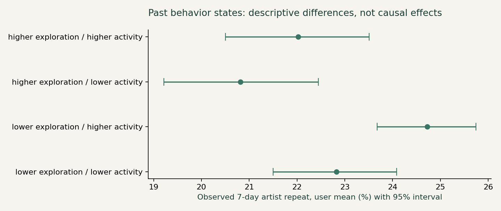

# Product decision memo

## Recommendation

Prioritize a small, concrete user-research study before committing engineering effort to recent-discovery retrieval. Compare it against active exploration and familiar-content access. Historical listening patterns provide a research context; they do not establish retrieval friction or rank the causal value of these features.

## What the data establishes

Parsed all **19,150,868** original author-published records with zero parser rejects. The conservative analysis window retains **18,993,371** records and **991** listeners. There are **661,390** eligible first-artist events from **932** users. Main user-weighted observed 7-day artist repeat is **22.73%**, 95% user-cluster bootstrap interval **21.87%–23.57%**. The event-weighted proportion is **20.54%**; heavier explorers influence that different estimand more.

| Cohort | Users | First-artist events | User mean | 95% interval |
|---|---:|---:|---:|---:|
| 60-day history | 932 | 661,390 | 22.73% | 21.87%–23.57% |
| 90-day history | 902 | 613,602 | 22.89% | 22.02%–23.75% |
| Reliable ID subset | 932 | 593,598 | 23.09% | 22.24%–23.95% |
| Common 28-day cohort | 914 | 645,924 | 22.86% | 21.99%–23.72% |

Read group proportions alongside new-artist volume and active days. A lower repeated fraction can arise mechanically when more new artists enter the denominator. The same user may appear in different states; groups are not randomized and differences do not establish that changing exploration changes future use.

## What remains unknown

The file contains **157,497** records at or after the conservative exclusive 2009-05-05 cutoff, including June 2009 and two timestamps in 2010/2013. Preserve the full raw span in QC; do not use the extreme maximum to imply full observation. Timestamp anomalies, missing synchronization and artist identity can alter interpretation.

No recommendation exposure, intent, retrieval attempts, bookmarks, subscriptions, skips or duration are available. One-time listening could represent satisfied exploration, dislike, failed retrieval, or missing logs. No participant, usability, revenue or feature-lift result has been measured.

## Next evidence and investment gate

Ask consenting listeners about the last artist they wanted to hear again: what they remembered, the path they used, whether it worked, and when one listen was enough. Keep counterexamples. If concrete retrieval-friction episodes recur, test one narrow recent-discovery entry point against a baseline information layout. Measure task success, time and mistakes. If that need is unsupported, retain simpler discovery/familiar-content experiences or improve measurement first.

For a future real experiment, add exposure, entry point, click, play start, feedback and errors; randomize eligible users and keep zero-discovery users in the primary denominator. Do not reuse the conditional first-artist repeat proportion as an unqualified causal KPI.
